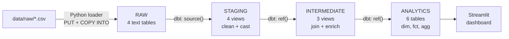
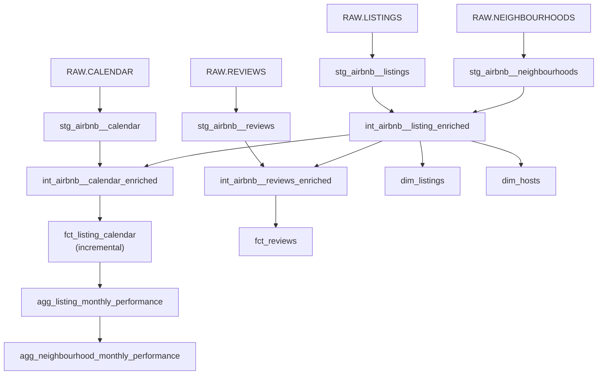

# Airbnb Snowflake dbt Analytics Project

An end-to-end analytics engineering project. It loads the [Inside Airbnb](https://insideairbnb.com/get-the-data/) open dataset into Snowflake, transforms it with dbt, tests the data, and shows the result in a Streamlit dashboard.

New here? Read [PROJECT_GUIDE.md](PROJECT_GUIDE.md) first, then [FILES_AND_FOLDERS.md](FILES_AND_FOLDERS.md) for what every folder and file does. It explains the whole project and the data end to end, and follows one real row from the CSV file to the dashboard.

Every file is commented line by line for beginners, and every dbt keyword is explained in the file where it is first used (see [Where each dbt concept is explained](#where-each-dbt-concept-is-explained)).

## Run it

Step-by-step commands for **Mac and Windows**, from installing Python to opening the dashboard, are in [HOW_TO_RUN.md](HOW_TO_RUN.md).

The short version, once the packages are installed and `profiles.yml` holds your Snowflake login:

```bash
python run_pipeline.py
```

| Step | Command it runs | What happens |
| --- | --- | --- |
| 1 | `python scripts/load_inside_airbnb_to_snowflake.py` | Creates the database, warehouse, schemas, stage and file format, then loads the four CSV files into the `RAW` schema |
| 2 | `dbt debug --connection` | Checks the dbt configuration and the Snowflake connection |
| 3 | `dbt run` | Builds 13 models: 7 views, 5 tables, 1 incremental table |
| 4 | `dbt test` | Runs 46 data quality tests |
| 5 | `dbt docs generate` | Builds the documentation site files |

Options:

```bash
python run_pipeline.py --full-refresh    # rebuild the incremental table from zero
python run_pipeline.py --dashboard       # open the dashboard when the pipeline finishes
```

Afterwards:

```bash
streamlit run dashboard/streamlit_app.py     # dashboard at http://localhost:8501
dbt docs serve --profiles-dir .              # docs and lineage graph at http://localhost:8080
```

The dbt commands end with `--profiles-dir .`, which tells dbt to use the `profiles.yml` in the project folder. dbt would find it there anyway when you run the command from the project folder (it looks in the current folder first, then in `~/.dbt/`). Writing the flag makes the choice explicit.

## How the data flows





| Layer | Snowflake schema | Built as | Job |
| --- | --- | --- | --- |
| Raw | `RAW` | tables (by the loader) | Untouched copy of the CSV files, every column is text |
| Staging | `STAGING` | views | Clean one raw table each: rename, cast types, trim |
| Intermediate | `INTERMEDIATE` | views | Join staging models and add reusable business logic |
| Marts | `ANALYTICS` | tables | Final dimension, fact and aggregate tables for the dashboard |

## Project structure

```text
.
├── PROJECT_GUIDE.md                     the whole project and the data, explained end to end
├── HOW_TO_RUN.md                        step-by-step commands for Mac and Windows
├── FILES_AND_FOLDERS.md                 every folder and file explained
├── run_pipeline.py                      one command that runs everything
├── setup_mac.sh                         one-time setup script for Mac
├── setup_windows.bat                    one-time setup script for Windows
├── dbt_project.yml                      dbt project settings (paths, schemas, materializations)
├── profiles.yml.example                 template for your private profiles.yml
├── requirements.txt                     Python packages
├── setup/
│   └── snowflake_setup.sql              database, warehouse, schemas, stage, file format
├── scripts/
│   └── load_inside_airbnb_to_snowflake.py   loads data/raw into the RAW schema
├── data/raw/                            the four Inside Airbnb files
├── macros/
│   ├── cleaning.sql                     clean_price, clean_percent, to_boolean
│   └── generate_schema_name.sql         gives schemas clean names
├── models/
│   ├── staging/                         4 models + sources and tests
│   ├── intermediate/                    3 models + tests
│   └── marts/                           6 models + tests
├── tests/                               2 singular (custom SQL) tests
└── dashboard/
    └── streamlit_app.py                 the dashboard
```

`profiles.yml`, `.venv/`, `target/`, `logs/` and `.user.yml` are created locally and ignored by git.

## Where each dbt concept is explained

| Concept | Explained in |
| --- | --- |
| What dbt is, `dbt_project.yml`, folder paths, `+` configs, `materialized` (view, table, incremental, ephemeral), `persist_docs` | `dbt_project.yml` |
| `profiles.yml`, profile, target, outputs, threads | `profiles.yml.example` |
| Jinja (`{{ }}`, ``, comments), macros, whitespace control | `macros/cleaning.sql` |
| Overriding a built-in macro, `target`, filters | `macros/generate_schema_name.sql` |
| Sources, `source()`, generic tests (`not_null`, `unique`) | `models/staging/_staging_sources.yml` |
| Properties files, `accepted_values`, `relationships` | `models/staging/_staging_models.yml` |
| What a model is, the CTE pattern, calling macros | `models/staging/stg_airbnb__calendar.sql` |
| `ref()`, the dependency graph (DAG), `source()` versus `ref()` | `models/intermediate/int_airbnb__listing_enriched.sql` |
| `config()`, incremental models, `merge`, `unique_key`, `on_schema_change`, `cluster_by`, `is_incremental()`, `this`, `--full-refresh` | `models/marts/fct_listing_calendar.sql` |
| Fact versus dimension tables, grain, aggregation | `models/marts/dim_hosts.sql`, `models/marts/dim_listings.sql` |
| Singular tests and how a test passes or fails | `tests/assert_no_duplicate_listing_calendar.sql` |
| `dbt debug`, `run`, `test`, `docs generate`, `build` | `run_pipeline.py` |
| Seeds, snapshots and analyses (not used here, described in one line each) | `dbt_project.yml` |

## About the data

The files in `data/raw/` are one Inside Airbnb snapshot of Albany, New York, collected on 15 February 2026: 453 listings, 165,345 calendar rows, 27,892 reviews and 15 wards. [PROJECT_GUIDE.md](PROJECT_GUIDE.md) describes the data in detail.

Two things to know:

- **This snapshot has no prices.** The `price` column is empty for every listing and every calendar row. The price and revenue columns in the models are therefore empty or zero, and the dashboard shows unavailable nights instead of revenue. The models are ready for a snapshot that does include prices: replace the files in `data/raw/` and run `python run_pipeline.py --full-refresh`.
- **Revenue is an estimate.** Inside Airbnb has no booking data. The project treats a night that is no longer available as booked and counts its price as revenue.

## Security

`profiles.yml` contains your Snowflake password and is ignored by git. Never commit it. Only `profiles.yml.example`, which holds placeholders, is committed.

## Owner

Built by [Durgesh Yadav](https://github.com/analyticsdurgesh) as a Snowflake, dbt and analytics engineering portfolio project.
